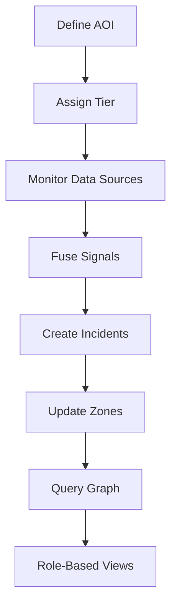
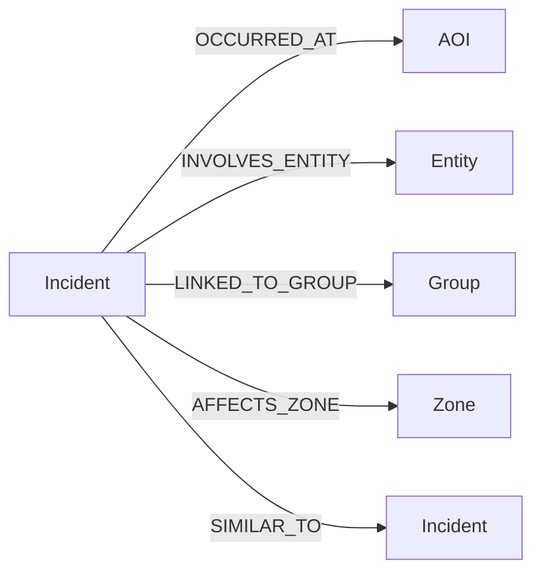
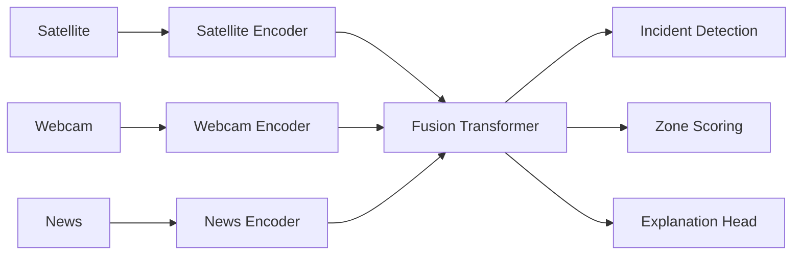

# SentinelFusion Specification

## 1. Overview and Vision

### Vision

SentinelFusion is an **AOI-centric incident brain** for defence and security teams. It continuously watches selected areas of the world, fusing satellite imagery, live webcams, and news into **understandable incidents**, terrain-aware risk maps, and plain-language narratives that analysts and field ops can act on in minutes.

The goal is not just prediction, but **persistent, understandable monitoring**:
- Show what is happening in each AOI.
- Explain why it matters.
- Recommend what to do next.

### Product idea

SentinelFusion is designed as a **self-serve, out-of-the-box intelligence layer**:

- Internal IT teams connect their existing data warehouses (Snowflake, Databricks).
- They define AOIs and tiers (e.g., inner city, borders, critical sites).
- The system starts monitoring those AOIs in real time, turning raw signals into incidents, heatmaps, no-go zones, and target zones.
- support field ops detect enemy neutrilize it

### User focus

SentinelFusion is **analyst-first**:

- Analysts can ask questions like "Show me recent incidents near Mumbai involving terrorist-related groups" and get grounded, plain-language answers backed by incidents, AOIs, and entities.
- Field ops receive ready-to-go plans (no-go zones, target zones, suggested routes) within minutes of an incident spike.

### Out of scope (for now)

To keep the project focused, the following are **explicitly out of scope** in this phase:

- Full drone integration (kept conceptual only).
- Deep, client-specific taxonomies or classified data; those will be handled as proprietary extensions later.
- Complex, production-grade deployment automation (we will design the wizard concept, not build a fully hardened SaaS).
- Full multi-city global coverage; we will focus on one region (e.g., Mumbai) as a demo.

***

## 2. Roles and Tenants

### 2.1 Roles

SentinelFusion supports four core roles:

- **Field Ops**
  - Goal: get a **topological plan** for missions.
  - See: AOI tiers, heatmaps, no‑go zones, target zones, suggested routes, enemy/ threat locations inferred from Wi‑Fi CSI, thermal, radar, and other sensors.
  - Actions: update incident status, mark zones, confirm routes, send field reports.

- **Analysts**
  - Goal: deep investigation and planning.
  - See: full incident history, current situation, AOI tiers, terrain zones, threat patterns, entity and group links.
  - Actions: run queries ("Show me recent incidents near Mumbai with terrorist-related groups"), define AOIs, tag entities, create hypotheses, recommend strike windows and entry/exit points.

- **Leadership**
  - Goal: understand, track, and progress mission-critical work.
  - See: filtered, high-level summaries of incidents, AOI status, mission criticality, progress against objectives.
  - Actions: read-only; no direct editing of operational data.

- **Crew Transport**
  - Goal: move people and assets safely.
  - See: where/when/how to enter and exit AOIs without enemy detection, no‑go zones, safe corridors, suggested observation points.
  - Actions: read-only; can mark transport routes as used/blocked if enabled.

Access rules:

- **Leadership and Crew Transport** are primarily **read-only** (with limited write for transport route status if enabled).
- **Field Ops and Analysts** have **write/action permissions** on incidents, zones, and operational recommendations.
- Field ops cannot see leadership names or any personal identifiers; they see roles and anonymised metadata only.

### 2.2 AOI tiers and update cadence

AOIs are defined using **boxes + polygons** and organised into four tiers:

- **Tier 1: Building**
  - Update frequency: **every second**.
  - Priority: **high**.
  - Visible to: Field Ops, Leadership, Crew Transport.
  - Use: real-time tactical decisions, live threat tracking, entry/exit planning.

- **Tier 2: Locality**
  - Update frequency: **every minute**.
  - Priority: **mid**.
  - Visible to: Field Ops, Crew Transport.
  - Use: neighbourhood-level activity, short-term threat evolution.

- **Tier 3: Surrounding builders**
  - Update frequency: **every 10 minutes**.
  - Priority: **low**.
  - Visible to: all roles.
  - Use: broader context, pattern detection, early warnings.

- **Tier 4: Space around everything (≈10 km radius)**
  - Update frequency: **every 30 minutes** or on mission-critical triggers.
  - Priority: **strategic**.
  - Visible to: all roles.
  - Use: strategic situational awareness, large-scale movement patterns.

This tiering directly drives what data is shown, how often it updates, and who can act on it.

### 2.3 Data sources and focus

- **Mandatory live sources**:
  - Satellite (thermal, RGB, later hyperspectral).
  - Live webcams.
  - News feeds.
- **History**:
  - Low to none in v1; historical layers will be added later.
- **Planned extensions (not in v1)**:
  - Social media, private CCTV.

Primary threat/incident types in scope:

- Protests, threats, unusual movement, drug shipments, lethal weapons, and other security-relevant patterns.

### 2.4 Terrain and AOI semantics

- **Heatmap**: high activity, driven by thermal imaging from satellite and later field ops reports.
- **No‑go**: too dangerous, too expensive, or low importance relative to risk.
- **Target**: where the entity is and what should be done to neutralise or normalise the threat.

The system must be able to **show routes** that respect these zones:
- Avoid no‑go areas.
- Prioritise safe corridors and suggested observation points.
- Align with target zones when planning operations.

### 2.5 Ontology-lite requirements

Minimum ontology entities:

- **AOI**
- **Group** (e.g., terror-related groups, protest groups)
- **Zone** (heatmap, no-go, target)
- **Entity** (people, organisations, assets)
- **Incident**
- **Role**

Onboarding wizard (v1 concept):

1. Pick event table + entity table in your warehouse.
2. Define AOIs on a map (boxes + polygons).
3. Map columns to ontology fields (time, location, entity, group, severity).
4. Define roles & permissions (Field Ops, Analyst, Leadership, Crew Transport).

This is built **from scratch** as a lightweight layer on top of Snowflake/Databricks, not as a heavy proprietary ontology.

### 2.6 Example missions (v1 scope)

- Monitor the **Punjab border** for terror-related groups with suspicious threat indicators.
- Monitor **cities** for terror-related attacks and related patterns.

Data fusion is initially a **mix** of satellite, hyperspectral/RGB, and news, even if not fully connected in v1.

Outputs for users:

- List of no‑go zones.
- Safe corridors and suggested observation points.
- Threat intelligence summaries and threat pattern descriptions.

***

## 3. AOI, Incident and Graph Design

### 3.1 AOI model

An **AOI (Area of Interest)** is a geographic region that SentinelFusion monitors continuously. AOIs are the primary spatial unit for data fusion, incident detection, and user interaction.

**Geometry**

- Supported shapes:
  - **Boxes** (latitude/longitude bounding boxes).
  - **Polygons** (ordered list of lat/lon points).
- Coordinate system: WGS84 (EPSG:4326).
- Each AOI has:
  - `id`
  - `name`
  - `geometry` (box or polygon)
  - `tier` (Tier 1–4)
  - `tenant_id` (for multi-tenant isolation)
  - `created_at`, `updated_at`

**Tiers**

AOIs are assigned one of four tiers, which control update frequency, priority, and visibility:

- **Tier 1: Building**
  - Update: every second.
  - Priority: high.
  - Visible to: Field Ops, Leadership, Crew Transport.
- **Tier 2: Locality**
  - Update: every minute.
  - Priority: mid.
  - Visible to: Field Ops, Crew Transport.
- **Tier 3: Surrounding builders**
  - Update: every 10 minutes.
  - Priority: low.
  - Visible to: all roles.
- **Tier 4: Space (~10 km radius)**
  - Update: every 30 minutes or on mission-critical triggers.
  - Priority: strategic.
  - Visible to: all roles.

Tiering is used to:

- Control how often data is fused and incidents are re-evaluated.
- Filter what each role sees in real time.
- Prioritise compute and bandwidth for high-tier AOIs.

**Lifecycle**

- AOIs are created via the onboarding wizard or by analysts.
- AOIs can be:
  - **Active** (monitored in real time).
  - **Archived** (kept for history, not actively monitored).
- AOI changes (geometry, tier, status) are logged for audit.

### 3.2 Incident model

An **Incident** is a fused event detected in one or more AOIs, derived from satellite, webcam, news, and other signals.

**Fields**

Each incident has:

- `id`
- `tenant_id`
- `aoi_ids` (list of AOI IDs involved)
- `time_window_start`, `time_window_end`
- `modalities_used` (e.g., satellite, webcam, news, thermal, Wi‑Fi CSI, radar)
- `type` (e.g., protest, threat, unusual movement, drug shipment, weapons movement)
- `severity` (e.g., low / medium / high / critical)
- `triage_label` (e.g., ignore / watch / escalate)
- `description` (human-readable summary)
- `entity_ids` (linked entities: people, groups, assets)
- `group_tags` (e.g., terror-related group names)
- `zone_impact` (which heatmap/no-go/target zones are affected)
- `created_at`, `updated_at`

**Incident creation**

- Incidents are created when fused signals in an AOI exceed configured thresholds.
- Multiple signals (e.g., thermal anomaly + news mention + webcam motion) can be combined to increase confidence.
- Incidents are attached to:
  - One or more AOIs.
  - Zero or more entities and groups.
  - Relevant zones (heatmap, no-go, target).

**Grouping and lifecycle**

- Incidents can be:
  - **Merged** if they refer to the same real-world event in overlapping AOIs and time windows.
  - **Split** if new evidence shows multiple distinct events.
- Lifecycle states:
  - `new` → `investigating` → `actionable` → `resolved` / `false_positive`.
- Field ops and analysts can update incident state and add notes.

### 3.3 Zone model (terrain intelligence)

**Zones** are semantic overlays on AOIs that describe operational meaning.

**Zone types**

- **Heatmap**
  - Meaning: high activity area.
  - Derived from: thermal imaging, incident density, field ops reports.
- **No‑go**
  - Meaning: too dangerous, too expensive, or low importance relative to risk.
  - Derived from: high severity incidents, threat patterns, cost/risk heuristics.
- **Target**
  - Meaning: where the entity is and what should be done to neutralise or normalise the threat.
  - Derived from: entity location, threat classification, mission objectives.

**Representation**

- Each zone has:
  - `id`
  - `aoi_id`
  - `type` (heatmap / no-go / target)
  - `geometry` (polygon or sub-region within AOI)
  - `severity_score` (numeric)
  - `valid_from`, `valid_until`
  - `source_incident_ids` (which incidents contributed)

Zones are used to:

- Generate safe routes and avoid dangerous corridors.
- Drive field-ops plans (entry/exit points, observation spots).
- Visualise risk for analysts and leadership.

### 3.4 Graph schema (incident knowledge graph)

The **Incident Knowledge Graph** connects AOIs, incidents, entities, groups, and zones into a queryable structure.

**Node types**

- **AOI**
  - Attributes: `id`, `name`, `tier`, `geometry`, `tenant_id`.
- **Incident**
  - Attributes: as defined above.
- **Entity**
  - Attributes: `id`, `type` (person/org/asset), `name`, `attributes`.
- **Group**
  - Attributes: `tag`, `description`, `risk_level`.
- **Zone**
  - Attributes: `id`, `type`, `aoi_id`, `geometry`, `severity_score`.
- **Tenant**
  - Attributes: `id`, `name`, `configuration`.

**Edge types**

- `OCCURRED_AT` (Incident → AOI)
- `INVOLVES_ENTITY` (Incident → Entity)
- `LINKED_TO_GROUP` (Incident → Group)
- `AFFECTS_ZONE` (Incident → Zone)
- `SIMILAR_TO` (Incident ↔ Incident)
- `FOLLOWS` (Incident → Incident, temporal sequence)
- `BELONGS_TO_TENANT` (AOI/Incident/Entity/Group → Tenant)

**Uses**

The graph supports queries like:

- "Show me recent incidents in or near Mumbai with terrorist-related groups."
- "Find all incidents in Tier 1 AOIs in the last 24 hours affecting target zones."
- "List entities that appear in multiple high-severity incidents across AOIs."

It also powers:

- Hotspot detection (dense incident clusters).
- Pattern mining (repeated sequences, similar incidents).
- Role-based views (analyst deep-dive, leadership summaries).

### 3.5 Example data flow

1. Sensors (satellite, webcam, news) stream data into the fusion pipeline.
2. Per-AOI fusion creates or updates incidents.
3. Incidents update zones (heatmap/no-go/target) within AOIs.
4. Incidents and zones are inserted into the graph with edges to AOIs, entities, groups.
5. Role-based views query the graph and zones to produce:
   - Field ops topological plans (routes, entry/exit).
   - Analyst summaries and optimal strike windows.
   - Leadership dashboards of mission-critical progress.

***

## 4. Data Sources and Ingestion Pipelines

### 4.1 Overview

SentinelFusion ingests **real-time and near-real-time data** from multiple open-world sources and fuses them into AOI-level incidents, zones, and graph nodes.

In v1, the focus is on:

- **Satellite imagery** (thermal, RGB; hyperspectral planned).
- **Live webcams**.
- **News feeds** (RSS/API).

All data is ingested into a **staging layer**, then transformed into AOI-aligned signals that feed the fusion and incident detection components.

### 4.2 Data sources

#### 4.2.1 Satellite

- **Types**:
  - Thermal imagery (for heatmaps and activity detection).
  - RGB imagery (for visual context and change detection).
  - Hyperspectral (planned, not in v1).
- **Update cadence**:
  - Tier 1 AOIs: as frequent as available, prioritised for high-priority regions.
  - Tier 2–4 AOIs: lower frequency, aligned with tier update rules.
- **Data format**:
  - GeoTIFF or similar georeferenced image formats.
  - Metadata: acquisition time, sensor type, cloud cover, resolution.
- **Use**:
  - Detect unusual heat patterns, large gatherings, infrastructure changes.
  - Contribute to heatmap and no-go zone scoring.

#### 4.2.2 Live webcams

- **Types**:
  - Public webcams in urban and border areas.
  - Later: private CCTV (out of scope for v1).
- **Update cadence**:
  - Continuous streams or frequent snapshots (seconds to minutes).
- **Data format**:
  - Video streams or periodic image snapshots.
  - Timestamped frames with location metadata.
- **Use**:
  - Detect motion, crowd formation, unusual activity.
  - Fuse with satellite and news to raise incidents.

#### 4.2.3 News feeds

- **Types**:
  - RSS feeds, news APIs, and open-source intelligence feeds.
- **Update cadence**:
  - Near real-time (minutes).
- **Data format**:
  - Text articles with timestamps, location mentions, and topics.
- **Use**:
  - Extract events (protests, threats, attacks, shipments).
  - Link mentions to AOIs and entities (e.g., terror-related groups).
  - Provide narrative context for incidents.

#### 4.2.4 Future / optional sources (out of v1 scope)

- Social media streams.
- Private CCTV feeds.
- Additional sensor types (e.g., radar, Wi‑Fi CSI) for later integration.

### 4.3 Multi-tenant data partitioning

All data is logically partitioned by **tenant**:

- Each AOI, incident, entity, and zone has a `tenant_id`.
- Raw data can be stored in tenant-specific tables or tagged with tenant metadata.
- Queries and pipelines filter by `tenant_id` to ensure isolation.

This supports multiple agencies or cities using the same platform without data leakage.

### 4.4 Per-modality pipeline outlines

Each modality follows a similar pattern: **ingest → preprocess → AOI-align → feature/embedding → fusion**.

#### 4.4.1 Satellite pipeline

1. **Ingest**
   - Pull new scenes from satellite providers/APIs.
   - Store raw images and metadata in a staging area.
2. **Preprocess**
   - Georeference and align to AOI coordinates.
   - Apply basic QA (cloud cover check, resolution filter).
3. **AOI crop**
   - For each AOI, crop relevant patches (Tier 1 prioritised).
4. **Feature extraction**
   - Run encoders to produce:
     - Thermal activity scores.
     - Change detection features.
     - Embeddings for downstream fusion.
5. **Output**
   - AOI-level embeddings and scores, timestamped, with source metadata.

#### 4.4.2 Webcam pipeline

1. **Ingest**
   - Connect to live webcam streams or periodic snapshots.
   - Store frames/clips in a time-indexed staging store.
2. **Preprocess**
   - Normalise resolution and frame rate.
   - Filter low-quality frames (blur, darkness).
3. **AOI association**
   - Map each camera to one or more AOIs based on location.
4. **Feature extraction**
   - Run motion detection, crowd detection, and activity encoders.
   - Produce clip-level embeddings and activity scores.
5. **Output**
   - AOI-level activity signals and embeddings, timestamped.

#### 4.4.3 News pipeline

1. **Ingest**
   - Pull articles from RSS feeds and news APIs.
   - Store raw text and metadata (source, timestamp, URL).
2. **Preprocess**
   - Clean text, extract location mentions and entities.
   - Tag articles with topics (protest, threat, attack, shipment).
3. **AOI association**
   - Map location mentions to AOIs using geocoding and AOI geometry.
4. **Feature extraction**
   - Run NLP models to produce:
     - Event embeddings.
     - Entity and group tags.
     - Sentiment / threat indicators.
5. **Output**
   - AOI-linked event signals and metadata.

### 4.5 Fusion and incident creation

- AOI-level signals from all modalities are combined in the **fusion layer**.
- The fusion component:
  - Aligns signals in time and AOI.
  - Computes a joint representation for each AOI/time window.
  - Applies thresholds and rules to create or update incidents.
- Incidents are then:
  - Attached to AOIs, entities, groups, and zones.
  - Inserted into the incident knowledge graph.

### 4.6 Data quality and cleaning (high-level)

In v1, data cleaning is kept simple and robust:

- **Satellite**:
  - Drop scenes with excessive cloud cover.
  - Ensure CRS consistency and valid timestamps.
- **Webcams**:
  - Skip frames with missing timestamps or severe corruption.
- **News**:
  - Remove duplicates and obvious spam.
  - Filter out non-relevant topics (e.g., sports, entertainment).

Detailed cleaning rules and thresholds are kept internal (proprietary).

***

## 5. Models and Multimodal Transformer

### 5.1 Overview

SentinelFusion uses a **multimodal transformer-based architecture** to fuse signals from satellite, webcams, and news into AOI-level representations that drive incident detection, zone scoring, and graph updates.

The model stack has three layers:

1. **Per-modality encoders** (satellite, webcam, news).
2. **Multimodal fusion transformer** (AOI-level joint representation).
3. **Task heads** (incident detection, zone scoring, explanations).

In v1, heavy computation runs in the cloud; edge components are conceptual and kept minimal.

### 5.2 Per-modality encoders

Each modality has its own encoder that maps raw inputs to **compact embeddings** and basic features.

#### 5.2.1 Satellite encoder

- **Input**:
  - Cropped AOI patches (thermal, RGB).
  - Metadata: time, sensor, resolution.
- **Architecture** (v1):
  - CNN or lightweight Vision Transformer (ViT) backbone.
  - Produces patch-level embeddings and global AOI embedding (via pooling).
- **Outputs**:
  - Embedding vectors per AOI/time window.
  - Derived features: thermal activity score, change score.

#### 5.2.2 Webcam encoder

- **Input**:
  - Video clips or frame sequences associated with AOIs.
- **Architecture** (v1):
  - 2D CNN for frame features + temporal model (simple RNN or temporal transformer) over frames.
  - Alternatively, a lightweight video transformer if available.
- **Outputs**:
  - Clip-level embeddings per AOI/time window.
  - Activity scores (motion, crowd-like patterns).

#### 5.2.3 News encoder

- **Input**:
  - Text articles linked to AOIs via geocoding.
- **Architecture** (v1):
  - Pretrained text transformer (e.g., BERT-like) fine-tuned to extract event embeddings and tags.
- **Outputs**:
  - Event embeddings per AOI/time window.
  - Entity and group tags (e.g., terror-related group mentions).
  - Topic indicators (protest, threat, attack, shipment).

All encoders are designed to be **modular**, so new modalities (e.g., radar, Wi‑Fi CSI) can be added later without changing the fusion core.

### 5.3 Multimodal fusion transformer

The **fusion transformer** is the core "AOI brain" that combines modality embeddings into a joint representation.

**Inputs**

- For each AOI and time window:
  - Satellite embedding + metadata.
  - Webcam embedding + metadata.
  - News embedding + metadata.
- Modality tags (SAT, CAM, NEWS) attached to each token.

**Architecture (v1)**

- Token construction:
  - Each modality embedding becomes a token with a modality type embedding.
- Transformer stack:
  - 2–4 layers of multi-head self-attention over modality tokens.
  - Standard feed-forward blocks, residual connections, layer norm.
- Handles missing modalities naturally (e.g., no webcam for some AOIs).

**Outputs**

- A joint AOI representation per time window.
- This representation is used by:
  - Incident detection head.
  - Zone scoring head.
  - Explanation/narrative head.

### 5.4 Task heads

#### 5.4.1 Incident detection head

- **Input**: joint AOI representation + recent history.
- **Function**:
  - Classify AOI/time windows into incident types (protest, threat, unusual movement, etc.).
  - Predict severity and triage label.
- **Output**:
  - Incident candidates with type, severity, and confidence scores.
  - These feed the incident model and graph.

#### 5.4.2 Zone scoring head

- **Input**: joint AOI representation + incident predictions.
- **Function**:
  - Score sub-regions within AOIs for heatmap, no-go, and target likelihood.
  - Use thresholds and simple rules to define zone boundaries.
- **Output**:
  - Zone polygons or masks with severity scores.
  - These update the zone model and graph.

#### 5.4.3 Explanation / narrative head (v1 simple)

- **Input**:
  - Incident predictions, zone scores, entity/group tags.
- **Function** (v1):
  - Generate structured summaries (templates + retrieved facts) for analysts and leadership.
  - Later: richer language models for plain-language narratives.
- **Output**:
  - Short text summaries like:
    - "High activity detected in AOI-1 over last hour; linked to group X; recommend treating corridor Y as no-go."

### 5.5 Edge–cloud split (conceptual for v1)

In v1, the system is primarily **cloud-centric**, with a simple edge concept:

- **Edge (conceptual)**:
  - Near-sensor preprocessing (e.g., basic motion detection on webcams, simple thermal thresholding on satellite).
  - Send only embeddings or event summaries to the cloud.
- **Cloud**:
  - Run full multimodal fusion transformer.
  - Incident detection, zone scoring, graph updates, and user-facing queries.

This keeps v1 simple while leaving room for real edge deployment later.

### 5.6 Training and evaluation (high-level)

- **Training data** (v1):
  - Historical satellite/webcam/news aligned with known incidents (where available).
  - Synthetic or weakly supervised labels for early prototypes.
- **Evaluation** (v1 focus):
  - Incident detection quality (precision/recall for key threat types).
  - Zone quality (do no-go/target zones align with expert judgement?).
  - Latency and update cadence per AOI tier.

Detailed training recipes and loss functions are kept internal (proprietary).

***

## 6. UI/UX and Role-Based Views

### 6.1 Design principles

SentinelFusion UIs are **role-first, AOI-centric, and action-oriented**:

- **Role-first**: Each role sees only what they need to decide and act.
- **AOI-centric**: The map and AOI list are the primary navigation; everything links back to AOIs, incidents, and zones.
- **Action-oriented**: Every view supports clear decisions (e.g., "mark as no-go", "escalate incident", "approve route").

General UX rules:

- Use simple visual hierarchies: map → AOI list → incident list → details.
- Keep dashboards uncluttered; highlight exceptions and high-priority items.
- Apply consistent color rules:
  - Green = safe / low risk.
  - Amber = watch / medium risk.
  - Red = danger / high risk / no-go.

### 6.2 Role-based views

#### 6.2.1 Analyst view

**Goal**: Deep investigation, planning, and hypothesis testing.

**Primary screens**

1. **AOI Explorer**
   - Map with all AOIs, colored by tier and risk.
   - Filters: tier, tenant, risk level, zone type (heatmap/no-go/target).
   - Click AOI → open AOI detail panel.

2. **AOI Detail**
   - Incident timeline for the AOI.
   - Zone overlays (heatmap, no-go, target).
   - Linked entities and groups.
   - Fusion summary: "What changed in this AOI in the last X hours?"

3. **Query & Search**
   - Natural-language or structured query box:
     - "Show me recent incidents in or near Mumbai with terrorist-related groups."
   - Results: list of incidents, map view, and summary narrative.

4. **Incident Workbench**
   - Detailed incident view: modalities used, signals, confidence, linked AOIs/entities.
   - Actions: change triage label, link/unlink entities, add notes, propose zone changes.

**Key capabilities**

- Create and edit AOIs.
- Tag entities and groups.
- Adjust incident states and triage.
- Review and propose zone changes.
- Run complex queries and save them as "views".

#### 6.2.2 Field Ops view

**Goal**: Get a topological plan: where, when, how to enter/exit, and where the enemy/threat is.

**Primary screens**

1. **Mission Map**
   - Map focused on assigned AOIs (Tier 1 and relevant Tier 2/3).
   - Overlays:
     - Heatmap zones.
     - No-go corridors.
     - Target zones.
     - Suggested routes (entry/exit).
   - **SLAM3R 3D Reconstruction** (NEW):
     - Toggle button: "Load 3D Scene".
     - Real-time dense 3D reconstruction of AOI from monocular RGB video feeds (webcams, drones, bodycams).
     - Point-cloud overlay showing buildings, obstacles, and potential cover.
     - Helps plan entry/exit routes with spatial awareness.

2. **Mission Brief**
   - List of active incidents in assigned AOIs.
   - Short narrative: "Current situation in AOI-1/2/3".
   - Threat summary: likely threat types, confidence, last update time.

3. **Route Planner**
   - Suggested routes with safe segments and no-go segments.
   - Alternative routes if primary is blocked.
   - Buttons: "Accept route", "Request alternative", "Mark segment blocked".

4. **Field Report**
   - Simple form to report what was seen:
     - Incident confirmation / denial.
     - New threats or observations.
   - Optionally attach photos or notes (later).

**Key capabilities**

- View AOIs, zones, and routes.
- Accept/modify routes.
- Update incident status and field observations.
- Mark zones as confirmed/blocked (within permissions).
- **SLAM3R integration**:
  - Load 3D scene for AOI from available RGB video sources.
  - Visualise reconstructed point cloud with safety overlays.
  - Use 3D view to plan routes and entry/exit points.

**Privacy constraint**

- Field ops cannot see leadership names or personal identifiers; they see roles and anonymised metadata only.

#### 6.2.3 Leadership view

**Goal**: Understand, track, and progress mission-critical work; see filtered, high-level summaries.

**Primary screens**

1. **Mission Overview Dashboard**
   - High-level KPIs:
     - Active high-severity incidents.
     - AOIs with critical status.
     - Missions in progress.
   - Trend lines: incidents over time, resolved vs ongoing.

2. **AOI Status Summary**
   - Map with AOIs colored by mission criticality.
   - Click AOI → short summary: key incidents, zone status, progress.

3. **Progress & Risk**
   - List of major operations / missions.
   - Status: on-track, at-risk, delayed.
   - Risks: top threats and bottlenecks.

**Key capabilities**

- Read-only access to operational data.
- Filter by tenant, region, mission.
- No direct editing of incidents or zones.

#### 6.2.4 Crew Transport view

**Goal**: Know where, when, how to enter and exit without enemy detection.

**Primary screens**

1. **Transport Map**
   - Map focused on routes between key points (bases, targets, safe zones).
   - Overlays:
     - No-go zones.
     - Safe corridors.
     - Suggested observation points.

2. **Route Cards**
   - List of suggested routes with:
     - Estimated time.
     - Risk level.
     - Key waypoints.
   - Status: available / blocked / in use.

3. **Route Status**
   - Simple interface to mark routes as used, blocked, or risky.
   - View updates from field ops and analysts.

**Key capabilities**

- View routes and zones.
- Update route status (if enabled).
- Read-only on incidents and AOIs.

### 6.3 Common UI components

Across all roles, the UI reuses these components:

- **Map component**:
  - AOI boxes/polygons.
  - Zone overlays (heatmap/no-go/target).
  - Incident markers with severity color.
- **AOI list**:
  - Sortable by tier, risk, last update.
  - Filters for tenant, role-specific views.
- **Incident list**:
  - Columns: time, AOI, type, severity, triage, linked groups.
  - Role-specific actions (e.g., escalate, confirm, mark resolved).
- **Narrative panel**:
  - Short, plain-language summaries of "what's happening" in selected AOIs.
- **Filters bar**:
  - By tier, zone type, incident type, time window, tenant.

### 6.4 Update cadence and role alignment

UI refresh rates align with AOI tiers:

- Tier 1 AOIs: near real-time updates (seconds) for field ops and leadership.
- Tier 2: minute-level updates.
- Tier 3: 10-minute updates.
- Tier 4: 30-minute or mission-critical updates.

Each role sees updates relevant to their tasks:

- Field ops: fast updates on Tier 1/2 AOIs and routes.
- Analysts: detailed updates across tiers, with drill-down.
- Leadership: aggregated, high-level updates.
- Crew transport: route-focused updates at appropriate cadence.

### 6.5 Implemented role → screens → components mapping (T27)

The tables below map each role to the screens and components actually implemented in `sentinelfusion-frontend/`. Routes are gated by `ProtectedRoute` with each role's access rules (see §2.1). All views share the `Header` (role badge + logout) and a per-view `Snackbar` toast system.

#### 6.5.1 Summary

| Role | Route | Access | Primary screens | Key components |
|---|---|---|---|---|
| **Analyst** | `/analyst` | `analyst` | AOI Explorer, AOI Detail, Query & Search, Incident Workbench | `ThreeColumnLayout`, `AOISidebar`, `MapContainer`, `AOILayer`, `IncidentLayer`, `AOIDetailPanel`, `QuerySearch`, `IncidentPanel`, `IncidentForm`, `AOIForm`, `IncidentTimeline` |
| **Field Ops** | `/field-ops` | `field_ops` | Incident Queue (Mission Brief), Incident Details, Field Report (notes) | `IncidentList`, `IncidentDetails`, `NoteDialog`, `FieldOpsBottomNav`, `ErrorState` |
| **Leadership** | `/leadership` | `leadership` | Mission Overview Dashboard, Charts, Activity Feed, Export Report | `KPICards`, `IncidentsByTypeChart`, `SeverityDistributionChart`, `IncidentTrendChart`, `ActivityFeed`, `DateRangeSelector`, `ExportReportButton` |
| **Crew Transport** | `/crew-transport` | `crew_transport` | Transport Routes, Route Details | `AssignmentList`, `AssignmentDetails`, `RouteCard`, `NoteDialog` |

#### 6.5.2 Analyst

| Screen | Purpose | Key components used |
|---|---|---|
| **AOI Explorer** | Three-column layout: AOI sidebar, live Leaflet map, incident panel. AOIs drawn as tier/status-coloured polygons, incidents as severity-coloured markers; layers toggleable. | `ThreeColumnLayout`, `AOISidebar`, `MapContainer`, `AOILayer`, `IncidentLayer` |
| **AOI Detail** | Selected AOI's tier, status, fusion summary, terrain zones, incident timeline, and on-demand **Run AI analysis** (multimodal prediction with confidence). | `AOIDetailPanel`, `aiApi.runAOPrediction` |
| **Query & Search** | Natural-language style query box that filters incidents by type, description, group tags, triage, and AOI name. | `QuerySearch` |
| **Incident Workbench** | Create/edit incidents, triage label, severity/status chips, and a timeline of activity events. | `IncidentPanel`, `IncidentForm`, `IncidentTimeline` |
| **AOI Management** | Create/edit/delete AOIs with inline validation (name required, valid coordinates). | `AOISidebar`, `AOIForm`, `ConfirmDialog` |

#### 6.5.3 Field Ops

| Screen | Purpose | Key components used |
|---|---|---|
| **Incident Queue** | Mobile-first list of assigned incidents: status filter, sort, and "assigned to me" toggle; cards show type, severity, status, location, and time since created. | `IncidentList` |
| **Incident Details** | Full incident view with Start/Complete status actions, Add Note dialog, Google Maps navigation, and activity timeline. | `IncidentDetails`, `IncidentTimeline`, `NoteDialog` |
| **Bottom Navigation** | Fixed mobile bottom nav (home / incidents / profile). | `FieldOpsBottomNav` |

#### 6.5.4 Leadership

| Screen | Purpose | Key components used |
|---|---|---|
| **KPI Dashboard** | Six KPI cards with trend indicators (total AOIs, active incidents, response time, resolution rate, field ops active, critical incidents). | `KPICards` |
| **Charts** | Incidents by type (bar), severity distribution (pie), and incident trend over time (line) — Recharts. | `IncidentsByTypeChart`, `SeverityDistributionChart`, `IncidentTrendChart` |
| **Activity Feed** | Recent operations feed (incident created, status change, AOI added/updated, mission completed). | `ActivityFeed` |
| **Date Range & Export** | 7/30/90-day + custom range selector, and PDF report export. | `DateRangeSelector`, `ExportReportButton` (react-pdf) |

#### 6.5.5 Crew Transport

| Screen | Purpose | Key components used |
|---|---|---|
| **Transport Routes** | Mobile-first list of transport assignments: status filter, ETA/vehicle chips, "assigned to me" badge. | `AssignmentList` |
| **Route Details** | Route visualization (inline SVG), Start/Complete actions, Add Note, Google Maps navigation, route notes. | `AssignmentDetails`, `RouteCard`, `NoteDialog` |

#### 6.5.6 Shared and setup flows

| Flow | Purpose | Key components used |
|---|---|---|
| **Authentication & RBAC** | Login, JWT session management, protected routes with role gating, profile, unauthorized page. | `LoginPage`, `ProfilePage`, `UnauthorizedPage`, `ProtectedRoute`, `AuthContext` |
| **Onboarding wizard (T29)** | Connect warehouse → select tables → define AOIs → map columns → assign roles; scaffolds the §2.5 ontology-lite flow. | `OnboardingWizard`, `WarehouseStep`, `TablesStep`, `AOIStep`, `ColumnMappingStep`, `RolesStep` |
| **Common building blocks** | Header with role badge + logout, error/retry states, confirmation dialogs, note dialog. | `Header`, `ErrorState`, `ConfirmDialog`, `NoteDialog` |

***

## 7. Evaluation and Research Tracks

### 7.1 Evaluation metrics

#### 7.1.1 Model metrics

- **Incident detection**:
  - Precision, recall, F1 for key incident types (protest, threat, unusual movement, etc.).
- **Zone scoring**:
  - Alignment of predicted zones with expert-labeled zones (IoU, precision/recall).
- **Fusion quality**:
  - Improvement in detection when using multimodal vs single-modality inputs.

#### 7.1.2 Incident metrics

- **Incident quality**:
  - Precision/recall of incident detection vs ground truth.
  - Severity calibration (do high-severity predictions match actual high-impact events?).
- **Graph utility**:
  - Quality of hotspot detection and pattern mining (analyst feedback).

#### 7.1.3 Edge–cloud metrics

- **Latency**:
  - Time from signal arrival to incident creation.
- **Bandwidth**:
  - Data volume sent from edge to cloud.
- **Resource usage**:
  - Compute and memory footprint per AOI tier.

#### 7.1.4 Analyst-level demos

- **Narrative quality**:
  - Clarity and usefulness of plain-language summaries.
- **Decision speed**:
  - Time from incident spike to field-ops-ready plan.

### 7.2 Research tracks and potential papers

#### Track A: AOI Brains

- **Paper**: "AOI Brains: Real-Time Multimodal Incident Monitoring Over Open-World Data"
- **Focus**: Tiered AOI framework, terrain zoning, real-time fusion.

#### Track B: Analyst-First Intelligence

- **Paper**: "Analyst-First Multimodal Intelligence: From Incidents to Plain-Language Narratives"
- **Focus**: Role-based UIs, grounded language narratives, query interface.

#### Track C: Ontology-Lite Platform

- **Paper**: "Connected Ontologies Without Data Ingestion: AOI-Centric Intelligence on Snowflake and Databricks"
- **Focus**: Lightweight ontology, self-serve wizard, warehouse integration.

#### Track D: More Than Prediction

- **Paper**: "More Than Prediction: Understanding Real-Time Security Incidents via Multimodal AOI Analysis"
- **Focus**: Continuous monitoring, explainability, terrain-aware zoning.

#### Track E: Terrain Intelligence (optional)

- **Paper**: "Terrain Sentinel: AOI Tiering and Zone Classification for Real-Time Security Operations"
- **Focus**: Heatmap/no-go/target zone derivation from satellite and incident data.

#### Track F: SLAM3R Integration (NEW)

- **Paper**: "SLAM3R-Enabled Field Ops: Real-Time 3D Scene Reconstruction for Mission Planning"
- **Focus**: Integration of SLAM3R for dense 3D reconstruction from monocular RGB video, route planning in 3D, spatial awareness for field ops.

***

## 8. Process: RACI, Kanban, Roadmap

### 8.1 RACI matrix (high-level)

| Subsystem | Responsible | Accountable | Consulted | Informed |
|-----------|-------------|-------------|-----------|----------|
| AOI model | Ridhesh | Ridhesh | T | Team |
| Incident model | Ridhesh | Ridhesh | T | Team |
| Graph schema | Ridhesh | Ridhesh | T | Team |
| Data pipelines | Ridhesh | Ridhesh | T | Team |
| Models & fusion | Ridhesh | Ridhesh | T | Team |
| UI/UX | T | T | Ridhesh | Team |
| Evaluation | Ridhesh | Ridhesh | T | Team |
| SLAM3R integration | T | Ridhesh | T | Team |

### 8.2 Roadmap: Aug 3–21 milestones

- **Week 1**: Spec + AOI/incident foundation.
- **Week 2**: Pipelines + roles.
- **Week 3**: Evaluation + research framing.

### 8.3 Post-August roadmap

- Task-based list replacing date-based plan.
- Focus on:
  - Building v1 pipelines.
  - Integrating SLAM3R for field ops.
  - Refining ontology-lite wizard.
  - Preparing demo for Punjab border / Mumbai use case.

***

## Appendix: Diagrams and Scenario Sketches

### A.1 AOI flow diagram

### A.2 Incident graph diagram

### A.3 Multimodal pipeline diagram

***

This is the **complete spec** for SentinelFusion, including the **SLAM3R** feature for Field Ops.